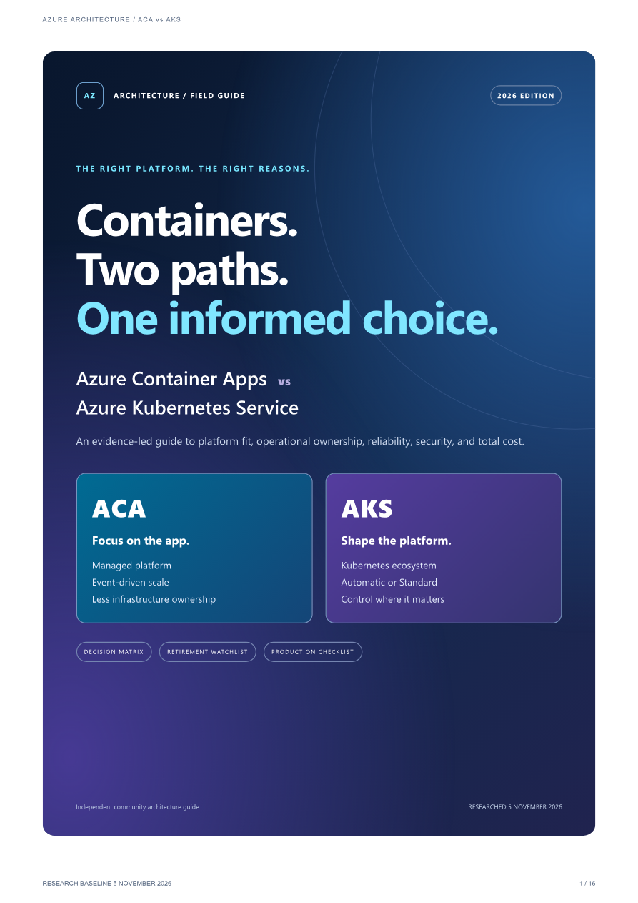
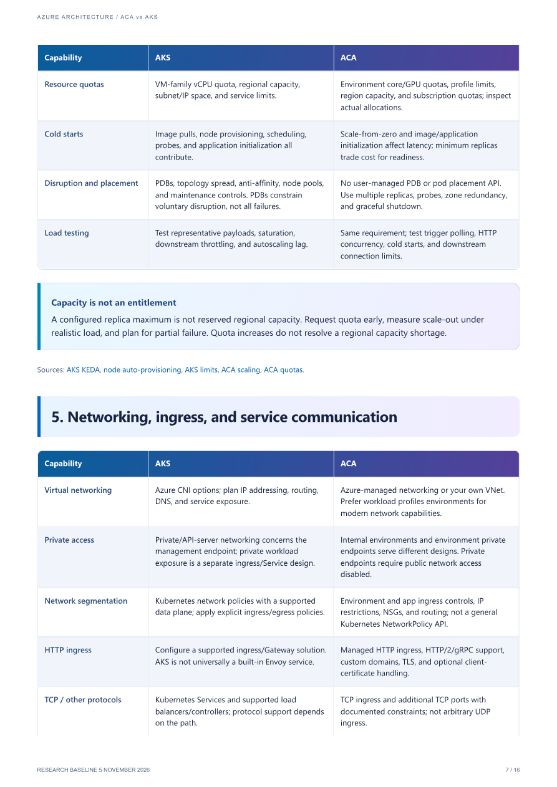

# Azure Container Apps vs Azure Kubernetes Service

[](https://github.com/lgmorand/aca-vs-aks/actions/workflows/build-pdf.yaml)
[](LICENSE)

**A practical, evidence-led architecture guide to choosing ACA, AKS Automatic, or AKS Standard.**

Research baseline: **5 November 2026**. Written for architects, platform engineers, and application teams who need a defensible decision, not a feature-count contest.

[Read the complete comparison](src/comparison.md) · [Download a CI build](https://github.com/lgmorand/aca-vs-aks/actions/workflows/build-pdf.yaml) · [Published releases](https://github.com/lgmorand/aca-vs-aks/releases)

## A new reading experience

The PDF now has a gradient cover, vibrant blue/purple section treatments, high-contrast comparison tables, an interactive contents page, bookmarks, source links, page numbers, and a visible research date. HTML is self-contained and responsive; DOCX stays editable with coordinated heading colors.

These are **actual rendered PDF pages**, regenerated by the build rather than illustrative mockups:

| Cover | Inside the comparison |
|---|---|
|  |  |

## Start with the decision

| Start here | When it fits |
|---|---|
| **Azure Container Apps** | Linux APIs, microservices, event-driven workers, and bounded jobs that fit a managed application platform. |
| **AKS Automatic** | You need Kubernetes APIs and ecosystem compatibility, with more platform defaults managed for you. |
| **AKS Standard** | You need explicit control over supported infrastructure, scheduling, networking, or extensions. |

Neither service is always cheaper or more resilient. Validate application constraints, regional support, operating ownership, total cost, and your own service-level objectives.

## What's covered

The [guide](src/comparison.md) contains 14 sections:

1. Executive decision matrix
2. Operating model, ownership, portability, and Azure Arc
3. Workloads, compute, GPUs, confidential compute, sidecars, and dynamic sessions
4. Autoscaling, scale to zero, limits, quotas, and performance
5. Networking, private access, ingress, Gateway API, WAF, and mTLS
6. Identity, secrets, certificates, security, and governance
7. Storage, application state, Dapr, integrations, and backup
8. Delivery, revisions, rollback, observability, and day-two operations
9. Reliability, SLA scope, availability zones, and disaster recovery
10. Billing, idle capacity, commitments, and total cost
11. Retirement and migration watchlist
12. Reference architectures
13. Production acceptance checklist
14. Research notes, documentation inconsistencies, and maintenance

### Important corrections in this refresh

- ACA **does** support Key Vault secret references, ordinary sidecars, third-party OpenTelemetry exports, and region-limited confidential compute.
- ACA's current documented maximum is **1,000 replicas per revision**, subject to quotas and capacity, not 300.
- AKS **Standard and Premium pricing tiers** include the control-plane uptime SLA; Premium adds LTS. AKS Automatic also has a separately scoped pod-readiness SLA.
- ACA zone redundancy requires configuration; it is not automatically enabled for all environments.
- Kubernetes API availability, pod readiness, and end-to-end application availability are different measures.
- Retired components are removed from new-design recommendations and retained only in migration guidance.

### Migration priorities

Review the [retirement watchlist](src/comparison.md#11-retirement-and-migration-watchlist) before reusing an existing design. It covers ingress-nginx/application-routing changes, Basic Load Balancer, Azure Linux 2.0, OS Guard preview, pod-managed identity, kubenet, and legacy ACA environment choices. Preview and region-limited capabilities are qualified rather than presented as universally available.

## Download the documents

Open a successful [Generate offline version workflow run](https://github.com/lgmorand/aca-vs-aks/actions/workflows/build-pdf.yaml) and download the **Generated documents** artifact. GitHub may require you to sign in to download artifacts. Builds are retained for 60 days; older published versions may also be available in [Releases](https://github.com/lgmorand/aca-vs-aks/releases).

The artifact contains:

- `ACA-vs-AKS-comparison-guide.pdf` — print-ready A4 guide with clickable links, PDF bookmarks, and tagging.
- `ACA-vs-AKS-comparison-guide.docx` — editable Word document with a table of contents.
- `ACA-vs-AKS-comparison-guide.html` — offline HTML with embedded styles and no external fonts or scripts.
- PDF screenshots and JSON link/PDF validation reports.

The workflow builds and uploads artifacts; it does **not** automatically create a GitHub Release. External documentation links still require internet access.

## Build locally

### Prerequisites

- **Node.js 22.13+**, or a supported newer LTS release; CI uses Node.js 24.
- **Pandoc 3.13**, available on `PATH`, for Word output. Get it from the [official Pandoc releases](https://github.com/jgm/pandoc/releases/tag/3.13).
- Chromium installed through Playwright as shown below.

No LaTeX distribution, Docker, external font service, or manual cover editing is required.

```shell
npm ci
npx playwright install chromium
npm test
npm run build
npm run check:links
```

On Linux CI/minimal machines, use `npx playwright install --with-deps chromium` to include required system libraries. On Windows PowerShell installations that block the npm script shim, use `npm.cmd` / `npx.cmd`.

If Pandoc is not on `PATH`, set `PANDOC_PATH` to its executable:

```powershell
$env:PANDOC_PATH = 'C:\Tools\Pandoc\pandoc.exe'
npm.cmd run build
```

Generated documents and reports are written to `output` (gitignored). The build also refreshes the two tracked screenshots in [media](media).

To generate HTML/PDF and screenshots without Pandoc:

```shell
npm run preview
```

Open the generated HTML directly in a browser. `preview` is a one-shot build, not a web server. The DOCX table of contents may need a field refresh in Word after editing.

## Publishing and validation

The [workflow](.github/workflows/build-pdf.yaml) runs on pushes to `main`, pull requests, manual dispatch, and a monthly schedule.

- Locked npm dependencies make installs reproducible.
- Tests check Markdown structure, heading IDs, comparison table shape, source coverage, and document helpers.
- The renderer checks HTML table overflow and exports tagged PDFs with bookmarks.
- PDF inspection checks every page for body content, out-of-page text, required guide content, section bookmarks, structural tagging, and clickable links. It then rasterizes real PDF pages for the README.
- The link audit checks local files and Markdown anchors, HTTP status, redirects, and HTML fragment targets. It retries transient failures and fails explicitly for unresolved links.
- Audit reports are uploaded even when a later validation step fails.

Automatic checks cannot prove architectural suitability, perfect pagination, or legal SLA eligibility. Inspect the PDF visually and validate claims in the target Azure region/subscription before a production decision.

### Content and design

| Surface | Source |
|---|---|
| Architecture content and research date | [src/comparison.md](src/comparison.md) |
| Cover, typography, gradients, tables, and print layout | [assets/guide.css](assets/guide.css) |
| Semantic HTML and cover structure | [scripts/guide.mjs](scripts/guide.mjs) |
| PDF/DOCX build | [scripts/build.mjs](scripts/build.mjs) |
| Word heading styles | [scripts/reference-doc.mjs](scripts/reference-doc.mjs) |
| Link audit | [scripts/check-links.mjs](scripts/check-links.mjs) |
| PDF validation and screenshots | [scripts/inspect-pdf.mjs](scripts/inspect-pdf.mjs) |

## Research and contribution guidelines

This is an independent community guide, not official Microsoft documentation or a contractual commitment.

1. Cite the most specific current Microsoft documentation for changed claims.
2. Distinguish GA, preview, legacy, deprecated, and retired. Specify region, plan, OS, and version constraints where relevant.
3. Compare equivalent responsibilities and SLA scopes. Avoid blanket claims such as "unlimited," "always cheaper," or "compliant by default."
4. Prefer current Microsoft Entra terminology and supported identity/networking patterns.
5. Update the research baseline only after revalidating the content. Record material documentation conflicts in the research notes.
6. Run tests, build, and the link audit; inspect the PDF and commit the regenerated screenshots alongside content/design changes.

To propose a correction, [open an issue](https://github.com/lgmorand/aca-vs-aks/issues) or submit a pull request with sources and the affected deployment context. The monthly audit helps detect documentation drift; it does not automatically update Azure facts.

## Contributors

Original project contributors:

- [Louis-Guillaume MORAND](https://github.com/lgmorand)
- [Brice DEKANY](https://github.com/bdekany)
- [Yassine El Ghali](https://github.com/yelghali)
- [Damien Aicheh](https://github.com/damienaicheh)

## License

[Mozilla Public License 2.0](LICENSE).
